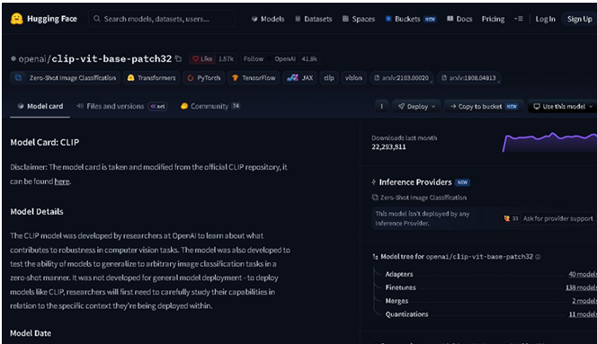
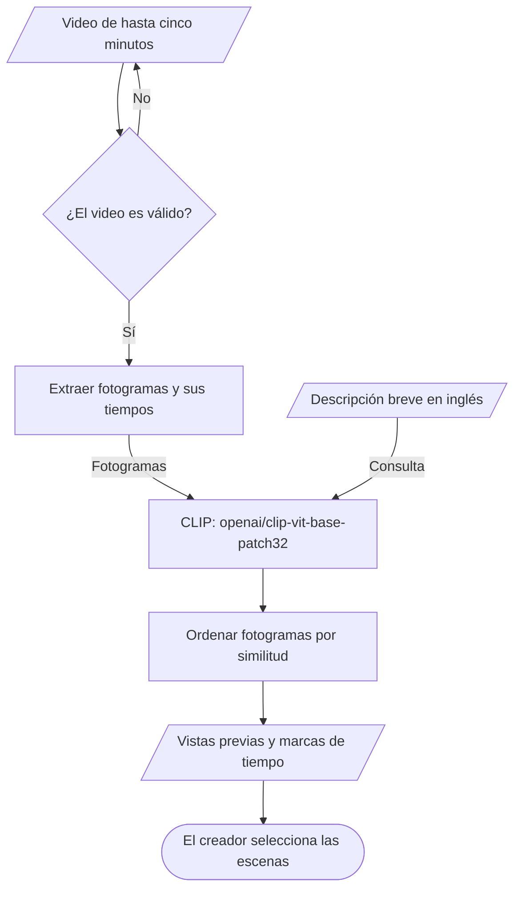
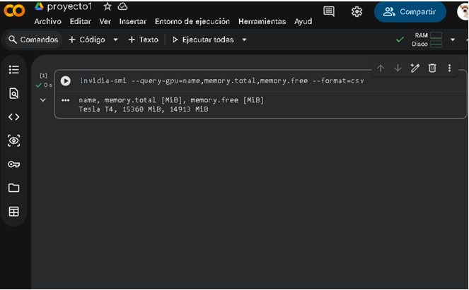

# ClipQuest

ClipQuest es un proyecto que busca ayudar a **creadores aficionados de contenido de Fortnite que editan sus propias grabaciones** a localizar escenas mediante una descripción breve. La primera versión recibirá un video de hasta cinco minutos y una consulta en inglés, y propondrá marcas de tiempo con vistas previas para que el creador seleccione los momentos que desea convertir en clips. Las pruebas iniciales se realizarán con grabaciones de Fortnite.

## Equipo

Herramientas de Procesamiento para IA · Grupo B · Equipo 1 · Ibero León · Otoño 2026

| Integrante | Papel en el proyecto |
| --- | --- |
| Diego Isaac Rico Hernández | Responsable del README y apoyo en la investigación de la problemática |
| César Iván Macías Anguiano | Investigación de la problemática |
| Ernesto Tehuintle Ramírez | Investigación de la problemática |
| Sebastián Guerrero Ambriz | Investigación de la problemática |

## Problemática

Para preparar clips de Fortnite, un creador debe localizar escenas dentro de sus grabaciones y revisar si corresponden a lo que quiere mostrar. Cuando recuerda una característica visual de la escena, pero no el momento en que ocurrió, necesita recorrer el video hasta encontrarla. ClipQuest propone una búsqueda por descripción que devuelva momentos candidatos y facilite esa revisión. El posible ahorro de tiempo y la relevancia de los resultados deberán comprobarse con grabaciones y consultas de prueba.

[Investigación de la problemática](docs/investigacion.md)

## Caso de uso

**Usuario:** creador aficionado que graba sus partidas de Fortnite y edita su propio contenido.

1. El usuario proporciona una grabación propia o autorizada de hasta cinco minutos.
2. Escribe una descripción breve en inglés de un elemento o una situación visible que quiere encontrar.
3. El sistema extrae fotogramas con sus marcas de tiempo y los compara con la descripción.
4. El usuario recibe momentos ordenados por similitud, acompañados de una vista previa y su tiempo dentro del video.
5. Revisa los resultados y decide qué fragmentos utilizar en su edición.

La primera versión se evaluará con un conjunto acotado de búsquedas visuales en Fortnite. El criterio de utilidad será encontrar escenas relacionadas con la consulta y facilitar su localización; la selección final del clip corresponde al creador.

## Modelo

| Dato | Descripción |
| --- | --- |
| Identificador | [`openai/clip-vit-base-patch32`](https://huggingface.co/openai/clip-vit-base-patch32) |
| Tarea en Hugging Face | `zero-shot-image-classification` |
| Aplicación en ClipQuest | Comparación entre una descripción de texto y los fotogramas extraídos de un video |
| Número de parámetros | Aproximadamente 151.28 millones |
| Licencia | MIT, según el [repositorio oficial de CLIP](https://github.com/openai/CLIP/blob/main/LICENSE) |
| Limitación textual de la Model Card | "CLIP currently struggles with respect to certain tasks such as fine grained classification and counting objects." |

La limitación se encuentra en la sección [Limitations de la Model Card](https://huggingface.co/openai/clip-vit-base-patch32#limitations). CLIP relaciona imágenes y texto; en este proyecto se aplicará a fotogramas individuales. El manejo del video, la conservación de tiempos y la presentación de resultados serán funciones de la aplicación. Las consultas iniciales serán en inglés, conforme al idioma de entrenamiento y evaluación indicado en la Model Card.

Captura de la Model Card consultada durante la Fase 1:

## Cómo funciona

## Infraestructura

La ejecución inicial se plantea en **Colab con GPU**, siguiendo la viabilidad explorada en la Fase 1. Esto permite experimentar con el modelo y procesar los fotogramas en lotes pequeños sin depender de que todos los integrantes tengan una GPU propia.

Con el valor aproximado de 151.28 millones de parámetros y dos bytes por parámetro en FP16, la memoria de los pesos se estima así:

$$
\begin{aligned}
M_{\text{pesos, FP16}} &= 151{,}280{,}000 \times 2\ \text{bytes} \\
&= 302{,}560{,}000\ \text{bytes} \\
&\approx 0.303\ \text{GB}
\end{aligned}
$$

Esta estimación cubre únicamente los pesos del modelo. Los fotogramas, las activaciones y las librerías requieren memoria adicional. En el Parcial III se medirán el consumo real y el tiempo de procesamiento; la GPU disponible en una sesión de Colab puede variar.

La siguiente captura de la Fase 1 muestra una Tesla T4 con 15,360 MiB de VRAM total en la sesión utilizada entonces:

## Riesgo ético

El riesgo principal es exponer conversaciones, nombres de usuario u otros datos personales presentes en las grabaciones. Se utilizarán videos propios o autorizados, se ocultarán los datos sensibles y las grabaciones quedarán fuera del repositorio público. En la aplicación se deberá limitar la conservación de archivos temporales al tiempo necesario para la búsqueda.

Los resultados también pueden ser poco relevantes o favorecer elementos visuales que CLIP reconoce mejor. Se presentarán como sugerencias para revisión del creador y se comprobarán con ejemplos de Fortnite. La puntuación de similitud servirá para ordenar resultados y no se interpretará como una probabilidad de acierto.

## Cambios respecto a la Fase 1

- **Público delimitado:** la propuesta se concentra en creadores aficionados que editan sus propias grabaciones de Fortnite, en lugar de abarcar jugadores con necesidades diferentes.
- **Necesidad concreta:** localizar escenas a partir de una descripción para facilitar la preparación de clips.
- **Alcance inicial acotado:** Fortnite, videos de hasta cinco minutos y consultas visuales en inglés.
- **Resultado definido:** marcas de tiempo y vistas previas que el creador revisa antes de seleccionar un fragmento.
- **Separación de la idea de antitrampas:** la detección de cheats mencionada en la Fase 1 queda fuera de esta versión. El sistema se orientará a la búsqueda de escenas para contenido.
- **Evaluación prevista:** medir la relevancia de los momentos propuestos y el tiempo de localización frente a una revisión manual, sin afirmar resultados que todavía no se han probado.

## Siguientes pasos

- [ ] Reunir grabaciones propias o autorizadas de Fortnite.
- [ ] Definir un conjunto de consultas visuales y anotar los momentos que corresponden a cada una.
- [ ] Implementar la carga y validación de videos de hasta cinco minutos.
- [ ] Extraer fotogramas conservando sus marcas de tiempo.
- [ ] Integrar CLIP para comparar los fotogramas con las descripciones en inglés.
- [ ] Mostrar resultados ordenados con sus vistas previas y tiempos.
- [ ] Evaluar si la escena buscada aparece entre los primeros resultados.
- [ ] Comparar el tiempo de búsqueda con una revisión manual y medir el uso de memoria.
- [ ] Aplicar las medidas de privacidad y eliminación de archivos temporales.
- [ ] Documentar los resultados, las limitaciones y la demostración del proyecto.

## Referencias

- OpenAI. [Model Card de openai/clip-vit-base-patch32](https://huggingface.co/openai/clip-vit-base-patch32). Arquitectura, tarea, idioma de uso y limitaciones del modelo.
- OpenAI. [Configuración de CLIP ViT-B/32 en Hugging Face](https://huggingface.co/openai/clip-vit-base-patch32/blob/main/config.json). Configuración de los codificadores de texto e imagen.
- OpenAI. [Licencia MIT del repositorio oficial de CLIP](https://github.com/openai/CLIP/blob/main/LICENSE).
- Radford, A. et al. (2021). [Learning Transferable Visual Models From Natural Language Supervision](https://arxiv.org/abs/2103.00020). Artículo original de CLIP.
