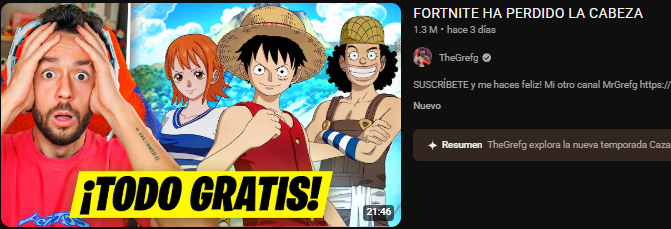
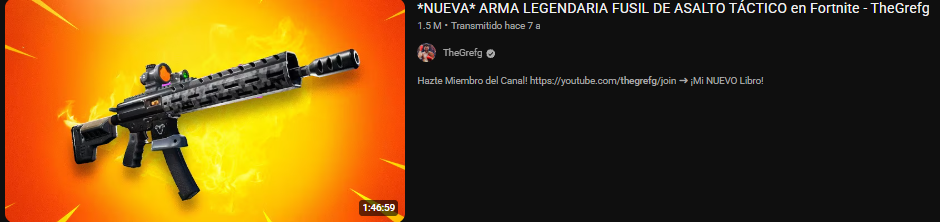

# Investigación de la problemática de ClipQuest

ClipQuest propone facilitar la búsqueda de escenas en grabaciones de Fortnite para creadores aficionados que editan sus propios videos. El avance de la Fase 2 documenta el problema, las alternativas disponibles y el diseño de un prototipo académico. Sus beneficios y metas se comprobarán durante el desarrollo del Parcial III; todavía no se presentan resultados de funcionamiento.

## El problema

Un creador que conserva grabaciones de sus partidas necesita seleccionar fragmentos para preparar contenido. Puede recordar un objeto, una situación o un elemento del escenario sin recordar su ubicación en el video. Encontrarlo exige revisar la grabación, desplazarse por la línea de tiempo y comprobar que la escena corresponde a lo que busca. El problema que aborda ClipQuest es esa localización previa a la edición.

La necesidad puede aparecer en sesiones extensas que contienen varias partidas. Sin embargo, no se supone una duración mínima universal de una partida ni se afirma que un video corto consiga más visitas por su duración. La propuesta se concentra en ayudar al creador a recuperar momentos que él considera útiles, conservando su criterio editorial.

Como contexto, el informe de YouTube Gaming de Stream Hatchet registra 8.8 mil millones de horas vistas durante 2025 y alrededor de seis millones de publicaciones de Shorts relacionadas con videojuegos en agosto de ese año [1]. Son indicadores de consumo de transmisiones y producción de contenido breve; no miden el tiempo de edición de un creador de Fortnite.

| Indicador | Cifra y periodo | Ámbito | Relación con el proyecto | Fuente |
| --- | --- | --- | --- | --- |
| Horas vistas en YouTube Gaming | 8.8 mil millones, durante 2025 | Transmisiones de videojuegos en YouTube Gaming | Describe el contexto de consumo de grabaciones y transmisiones; no demuestra por sí solo una necesidad de edición | [Stream Hatchet, informe 2025](https://hatchet.gg/resources/guides/2025-youtube-gaming-live-streaming-trends/) |
| Publicaciones de gaming en YouTube Shorts | Aproximadamente seis millones, en agosto de 2025 | Publicaciones cortas relacionadas con videojuegos | Contextualiza la producción de contenido breve al que puede destinarse una selección de escenas | [Stream Hatchet, informe 2025](https://hatchet.gg/resources/guides/2025-youtube-gaming-live-streaming-trends/) |

Para estudiar la necesidad concreta, el equipo comparará la búsqueda manual y la asistida sobre los mismos fragmentos. Se registrará si aparece el momento buscado y cuánto tarda la persona en localizarlo. Esto permitirá evaluar una hipótesis de utilidad sin atribuir al prototipo un ahorro todavía no medido.

Las siguientes capturas del canal TheGrefg, seleccionadas en la documentación del equipo, ilustran publicaciones de distinta duración. No constituyen una muestra representativa ni permiten atribuir diferencias de visitas a la duración.

Figura 1. Publicación con duración visible de 21:46. [Captura aportada por el equipo](https://github.com/user-attachments/assets/74116d36-d0b9-4039-a8ca-f21e0ee31691).

Figura 2. Publicación con duración visible de 1:46:59. [Captura aportada por el equipo](https://github.com/user-attachments/assets/a0e63c70-4f89-495d-adee-eaf3f377e920).

Aunque el problema incluye grabaciones largas, la primera versión procesará **fragmentos de hasta cinco minutos**. El creador proporcionará previamente un fragmento de su grabación. La evaluación medirá la búsqueda dentro de ese fragmento e informará por separado cualquier tiempo de preparación. Este alcance permite probar la idea antes de plantear sesiones completas.

## Cómo se resuelve hoy

Alternativas reales utilizadas actualmente

| Solución o alternativa | Qué ofrece | Limitaciones para este caso de uso |
| --- | --- | --- | --- |
| Revisión manual en línea de tiempo | Control absoluto fotograma a fotograma para encontrar momentos destacados de la partida. | Es extremadamente tardado y tedioso |
| Capítulos automáticos nativos | Segmentación automática basada en silencios o metadatos generales de la plataforma. | No entiende el contexto visual del juego |
| Herramientas de transcripción de voz (Speech-to-Text) | Búsqueda por palabras clave dichas por el creador en el audio del video. | Falla si el streamer pasa varios minutos concentrado sin hablar o si el momento clave solo tiene efectos de sonido y música. |
# Cómo se resuelve hoy

Existen procesos manuales y herramientas que ayudan a navegar o seleccionar contenido. La comparación distingue la función documentada de cada alternativa de su posible utilidad para ClipQuest. No pretende afirmar que todos los productos carezcan de otras funciones.

| Alternativa | Qué ofrece | Límite o diferencia para este caso de uso | Fuente |
| --- | --- | --- | --- |
| Revisión manual de la grabación | El creador reproduce y recorre el video hasta identificar el momento que recuerda. | La búsqueda depende de su memoria y de la revisión visual; será la referencia para comparar tiempos. | Proceso de referencia definido por el equipo. |
| Capítulos de YouTube | Secciones con títulos, tiempos y vistas previas; pueden ser manuales o automáticas. | Ayudan a navegar un video publicado, pero dividirlo en capítulos no equivale a buscar cualquier descripción visual. Los capítulos automáticos no están disponibles en todos los videos. | Ayuda de YouTube \[2\]. |
| Transcripciones de YouTube | Permiten localizar partes de un video con subtítulos y saltar desde el texto a su momento correspondiente. | Su utilidad depende de que el contenido buscado esté representado en la transcripción; una escena visual silenciosa puede no estar descrita. | Ayuda de YouTube \[3\]. |
| Detección automática de eventos de Medal | Genera clips o marcadores de eventos durante la grabación en juegos compatibles, entre ellos Fortnite. | El flujo documentado se centra en eventos detectados al grabar. Su utilidad debe distinguirse de una consulta visual posterior sobre un archivo elegido por el creador. | Soporte de Medal \[4\]. |
Existen procesos manuales y herramientas que ayudan a navegar o seleccionar contenido. La comparación distingue la función documentada de cada alternativa de su posible utilidad para ClipQuest. No pretende afirmar que todos los productos carezcan de otras funciones.

Alternativa

Qué ofrece

Límite o diferencia para este caso de uso

Fuente

Revisión manual de la grabación

El creador reproduce y recorre el video hasta identificar el momento que recuerda.

La búsqueda depende de su memoria y de la revisión visual; será la referencia para comparar tiempos.

Proceso de referencia definido por el equipo.

Capítulos de YouTube

Secciones con títulos, tiempos y vistas previas; pueden ser manuales o automáticas.

Ayudan a navegar un video publicado, pero dividirlo en capítulos no equivale a buscar cualquier descripción visual. Los capítulos automáticos no están disponibles en todos los videos.

Ayuda de YouTube [2].

Transcripciones de YouTube

Permiten localizar partes de un video con subtítulos y saltar desde el texto a su momento correspondiente.

Su utilidad depende de que el contenido buscado esté representado en la transcripción; una escena visual silenciosa puede no estar descrita.

Ayuda de YouTube [3].

Detección automática de eventos de Medal

Genera clips o marcadores de eventos durante la grabación en juegos compatibles, entre ellos Fortnite.

El flujo documentado se centra en eventos detectados al grabar. Su utilidad debe distinguirse de una consulta visual posterior sobre un archivo elegido por el creador.

Soporte de Medal [4].

Los capítulos, la transcripción y la captura por eventos cubren necesidades diferentes. ClipQuest evaluará una búsqueda posterior guiada por texto y mantendrá la edición final en manos del usuario.

La comparación con la revisión manual será necesaria para saber si aporta utilidad, especialmente porque localizar una escena sencilla podría resultar rápido sin IA.

## Por qué con IA y por qué este modelo

Una búsqueda basada únicamente en palabras del audio no recupera necesariamente lo que aparece en pantalla. La propuesta utiliza un modelo que relaciona imágenes y texto para comparar descripciones con fotogramas. El trabajo original de CLIP estudia esa asociación y su transferencia a distintas tareas visuales [2]. Esto justifica explorar su uso, pero no garantiza precisión en Fortnite.

Se conserva `openai/clip-vit-base-patch32`, elegido en la Fase 1. La Model Card describe sus codificadores de imagen y texto y advierte dificultades con categorías muy específicas y conteo de objetos [3]. Por ello, las primeras consultas se formularán en inglés y describirán elementos visibles; las búsquedas ambiguas y las acciones que requieren contexto temporal se tratarán como posibles limitaciones.

| Modelo | Parámetros aproximados | Licencia | Ventajas para el prototipo | Desventajas o aspectos por comprobar |
| --- | --- | --- | --- | --- |
| [CLIP ViT-B/32](https://huggingface.co/openai/clip-vit-base-patch32) | 151.28 millones | [MIT](https://github.com/openai/CLIP/blob/main/LICENSE) [4] | Continúa el trabajo de la Fase 1 y permite comparar imagen y texto; su cantidad de parámetros es menor que la de la alternativa indicada | Su desempeño con escenas y objetos de Fortnite no se ha medido; puede confundir detalles visuales o consultas poco precisas |
| [SigLIP base-patch16-224](https://huggingface.co/google/siglip-base-patch16-224) | La ficha indica 0.2B, aproximadamente 200 millones para el modelo completo | Apache 2.0, indicada en su ficha [5] | También permite recuperación imagen-texto; ofrece una alternativa para comparar los mismos casos | Tiene más parámetros que el CLIP elegido y aún no se dispone de mediciones locales de precisión, memoria o tiempo |

SigLIP introduce una función de pérdida sigmoide para el entrenamiento de pares imagen-texto [6]. Esa diferencia no demuestra por sí misma que sea más rápido o más preciso en este proyecto. La elección inicial de CLIP se justifica por continuidad, documentación disponible y una estimación menor de memoria de pesos; no supone una superioridad ya comprobada frente a SigLIP.

El modelo calculará la afinidad entre cada fotograma y la consulta. La aplicación se encargará de validar el video, extraer fotogramas, conservar sus tiempos, ordenar los resultados y mostrar vistas previas. Una puntuación alta servirá para ordenar candidatos; no se presentará como una probabilidad calibrada de que la escena sea correcta.

## Usuarios y requisitos

El usuario principal es un creador aficionado que graba Fortnite, maneja archivos de video y realiza su propia edición. No necesita conocimientos de programación. Puede recordar características visibles de una escena y aceptar revisar varios candidatos antes de elegir un fragmento. La propuesta no incluye detección de trampas ni decisiones sobre la conducta de otros jugadores.

La interfaz y el flujo de trabajo deberán comunicar el límite de cinco minutos y el uso inicial de consultas en inglés. También deberán distinguir las sugerencias del sistema de la decisión de publicación del creador. Los siguientes requisitos y criterios describen lo que se comprobará en el Parcial III.

| Requisito | Cómo se comprobará | Criterio de aceptación propuesto |
| --- | --- | --- |
| Recibir un video legible de hasta cinco minutos | Probar archivos válidos, dañados y de duración superior al límite | Aceptar archivos legibles dentro del límite e informar claramente los casos rechazados |
| Recibir una consulta breve en inglés | Probar consultas preparadas y entradas vacías | Solicitar una descripción no vacía y evitar la búsqueda cuando no hay consulta |
| Mostrar candidatos localizables | Revisar las salidas de las búsquedas de prueba | Presentar hasta cinco resultados con una vista previa y un tiempo que permita verificar el momento |
| Recuperar escenas relacionadas | Realizar 20 consultas con escenas de referencia anotadas previamente | Encontrar una escena válida entre los primeros cinco resultados en al menos 14 consultas, equivalente al 70 % |
| Medir la utilidad frente al proceso manual | Comparar las mismas consultas y fragmentos en ambas condiciones | Registrar tiempos y aciertos de ambos métodos, incluidos los casos donde la búsqueda manual resulte mejor |
| Proteger los archivos de entrada | Revisar la carpeta temporal y los archivos destinados al repositorio | Evitar la publicación del video original y eliminar los temporales al finalizar, cancelar o fallar la sesión |

La meta de 14 aciertos en 20 búsquedas fue aceptada como **propuesta de evaluación**, no como resultado obtenido. Cada consulta tendrá un intervalo de referencia marcado antes de ejecutar el sistema. Habrá acierto si al menos una de las primeras cinco marcas de tiempo cae en un intervalo que el equipo haya considerado válido para esa consulta.

La proporción se calculará como `consultas con acierto / 20`. Se conservará un registro de consultas, intervalos y resultados para revisar errores. Los ensayos manuales y asistidos se realizarán en condiciones comparables y se alternará su orden para reducir el efecto de recordar la escena. El tiempo de preparación del fragmento se registrará aparte. No se fija todavía un límite de segundos porque falta medir el entorno real.

## Impacto ético

**Privacidad y permisos.** Las grabaciones pueden contener conversaciones, nombres de usuario y otros elementos que identifiquen a personas. Se utilizarán archivos propios o autorizados; los ejemplos publicados deberán omitir o cubrir datos sensibles. Subir el video a Colab implica procesarlo en un servicio externo, por lo que esa condición deberá comunicarse al usuario. Los videos originales no formarán parte del repositorio público.

**Sesgos y límites.** El desempeño puede variar según los escenarios, personajes, iluminación, interfaz o forma de describir la escena. La Model Card de CLIP advierte que sus resultados dependen de las categorías y del contexto de evaluación [3]. El equipo probará consultas variadas y documentará fallos. Una limitación lingüística o visual no se atribuirá automáticamente a un error del creador.

**Consecuencias y responsabilidad.** Una sugerencia equivocada puede hacer perder tiempo o llevar al creador a seleccionar un fragmento distinto al deseado. El sistema mostrará los candidatos para revisión y no publicará automáticamente. El equipo será responsable de documentar límites y corregir fallos del prototipo; el creador conservará la responsabilidad de revisar el contenido y los permisos antes de compartirlo.

**Infraestructura y costo energético.** Colab con GPU es el entorno inicial propuesto, pero sus recursos no son ilimitados ni están garantizados [7]. Se registrarán el dispositivo utilizado, los minutos de procesamiento, la cantidad de fotogramas y las repeticiones. Con una potencia media estimada o medida, la energía puede expresarse como `E (kWh) = P_media (W) × tiempo (h) / 1000`. La estimación deberá indicar qué componentes incluye y no presentarse como una medición del centro de datos completo.

No se afirmará una huella de carbono sin información sobre energía y factores de emisión. Para limitar trabajo innecesario se reutilizarán los resultados del procesamiento de un mismo fragmento durante la sesión y se evitará repetir búsquedas idénticas sin propósito de evaluación.

| Riesgo | Personas afectadas | Mitigación prevista | Responsable | Verificación |
| --- | --- | --- | --- | --- |
| Exposición de conversaciones o identificadores | Creador y personas presentes en el video | Usar material autorizado, ocultar datos y mantener originales fuera del repositorio | Usuario y equipo de desarrollo | Revisar los ejemplos publicados y la lista de archivos que se compartirán |
| Resultados visuales poco relevantes | Creador | Mostrar candidatos, permitir revisión y registrar errores por tipo de consulta | Equipo de desarrollo y usuario | Conservar consultas y resultados de la evaluación |
| Conservación innecesaria de archivos | Personas identificables en las grabaciones | Eliminar temporales en finalización, cancelación y error | Equipo de desarrollo | Comprobar los tres escenarios durante las pruebas |
| Procesamiento repetido y consumo evitable | Equipo e infraestructura utilizada | Registrar ejecuciones y reutilizar el procesamiento de un fragmento durante la sesión | Equipo de desarrollo | Revisar tiempos, dispositivo y número de ejecuciones |

## Referencias

1. Stream Hatchet. *YouTube Gaming 2025 Live Streaming Trends Report*. [Informe y resumen oficial](https://hatchet.gg/resources/guides/2025-youtube-gaming-live-streaming-trends/).
2. Radford, A. et al. (2021). *Learning Transferable Visual Models From Natural Language Supervision*. [Artículo original de CLIP](https://arxiv.org/abs/2103.00020).
3. OpenAI. *Model Card de openai/clip-vit-base-patch32*. [Ficha del modelo](https://huggingface.co/openai/clip-vit-base-patch32).
4. OpenAI. *Licencia de CLIP*. [Licencia MIT](https://github.com/openai/CLIP/blob/main/LICENSE).
5. Google / Hugging Face. *google/siglip-base-patch16-224*. [Ficha, licencia y tamaño del modelo](https://huggingface.co/google/siglip-base-patch16-224).
6. Zhai, X., Mustafa, B., Kolesnikov, A. y Beyer, L. (2023). *Sigmoid Loss for Language Image Pre-Training*. [Artículo original de SigLIP](https://arxiv.org/abs/2303.15343).
7. Google. *Colaboratory: Frequently Asked Questions*. [Disponibilidad y límites de recursos](https://research.google.com/colaboratory/faq.html).

Fuentes consultadas el 4 de noviembre de 2026. Las figuras 1 y 2 son ejemplos ilustrativos aportados por el equipo; no se utilizan como evidencia estadística.
